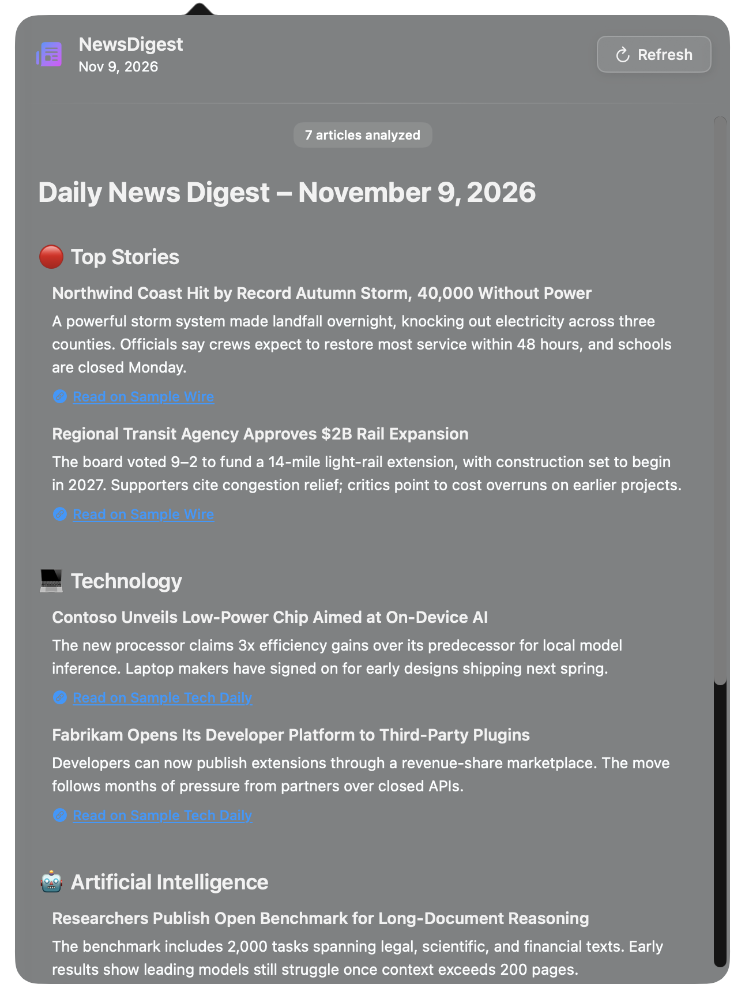
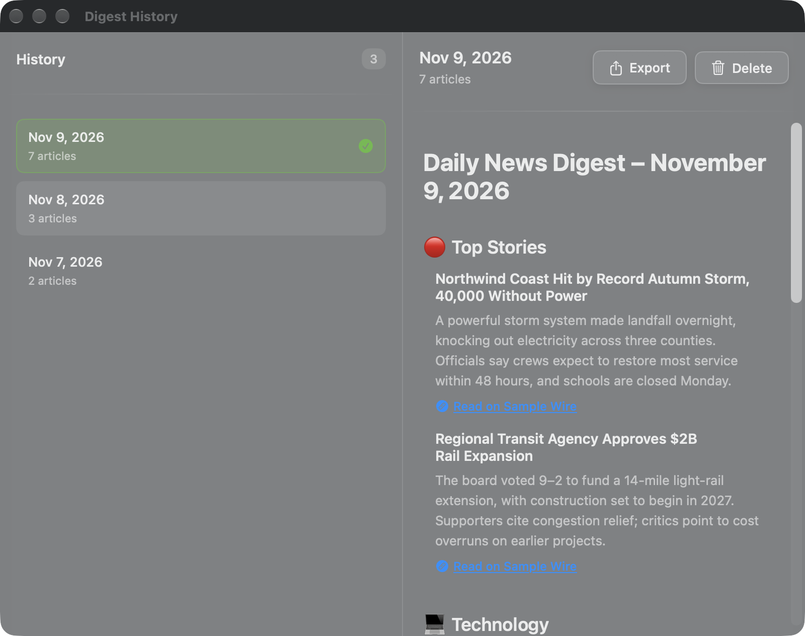
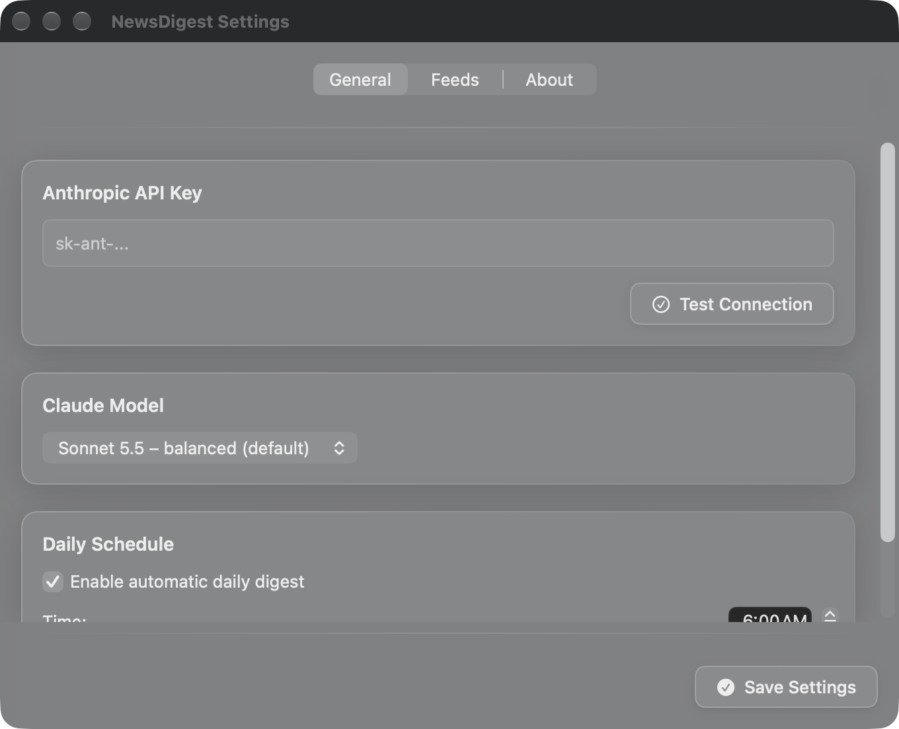
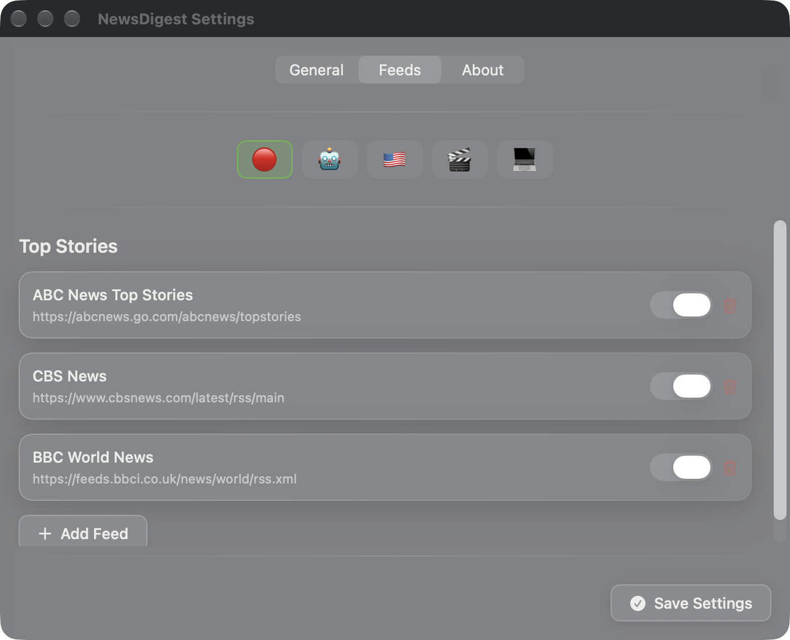

# News Digest

A native macOS menu bar app that reads your favorite RSS feeds every morning and has **Claude** write a short, de-duplicated news digest you can read in one glance.

<p align="center">
  
</p>

> Screenshots use **sample data** (fictional companies and `example.com` links), not real news.

## Features

- **Menu bar popover** with the latest digest, grouped by category, each story linking to its source
- **Claude-written summaries**: stories are filtered for impact, novelty and longevity, duplicates across outlets are merged, and headlines are rewritten to be clear rather than clickbait
- **Daily schedule** at the wall-clock time you choose (default 6:00 AM), correct across sleep/wake and daylight-saving changes
- **History window**: browse, export (Markdown) and delete past digests
- **Configurable feeds**: 15 defaults across 5 categories; add, remove or toggle any RSS 2.0 / Atom feed
- **Choice of Claude model** (Haiku / Sonnet / Opus) in Settings
- **Private by design**: API key in the macOS Keychain, App Sandbox on, no telemetry; the only network calls are your feeds and the Anthropic API

| History | Settings |
| --- | --- |
|  |  |

<p align="center">
  
</p>

## How it works

```
 RSS / Atom feeds ──► RSSFeedService ──► select(): dedupe, drop stale, cap per feed
                                                     │
                                                     ▼
 Menu bar UI ◄── DigestViewModel ◄── BackgroundDigestService ──► AnthropicService ──► Claude
      ▲                                     │                      (Codable request,
      │                                     ▼                       retry on 429/5xx)
 DigestParser ◄───────────────────── StorageService
 (Markdown → views)                  (~/Library/…/Digests/yyyy-MM-dd.md, Keychain)
```

| Layer | Files | Notes |
| --- | --- | --- |
| Models | `Article`, `FeedSource`, `NewsDigest`, `AppSettings`, `ClaudeModel`, `DigestParser` | Plain value types. `AppSettings` decodes older saved settings gracefully. |
| Services | `RSSFeedService`, `RSSParser`, `AnthropicService`, `BackgroundDigestService`, `SchedulerService`, `StorageService`, `Retry` | `AnthropicService` and `StorageService` take their dependencies (URLSession, key provider, directories) by injection so they're testable. |
| View models | `DigestViewModel`, `SettingsViewModel` | `@MainActor`, `ObservableObject`. |
| Views | `DigestView`, `DigestHistoryView`, `SettingsWindow`, `Components/` | SwiftUI hosted in AppKit (`NSStatusItem` + `NSPopover`). |

### Design decisions worth calling out

- **Token cost control.** Raw feeds can yield hundreds of items. Before calling Claude the app removes duplicate URLs, drops items older than 36 hours, caps each feed at 12 items and truncates each body to 600 characters.
- **Structured parsing of model output.** The prompt asks for a fixed Markdown shape; `DigestParser` turns it into typed elements (title, section, article with source and URL) so the UI renders cards and real links rather than raw Markdown.
- **Correct scheduling.** `NSBackgroundActivityScheduler` can't target a time of day, so `SchedulerService` computes the next occurrence of the chosen hour/minute and sleeps on `ContinuousClock` (which keeps counting while the Mac sleeps), recomputing after wake.
- **Honest retries.** Failures retry only when it can help (network errors, 408/429/5xx), never for a bad API key.
- **No WebKit in the feed path.** HTML in feed descriptions is stripped with a small regex pass instead of `NSAttributedString(html:)`, which is main-thread-only and heavy.
- **Keychain writes don't lose the key.** The key is updated in place rather than delete-then-add.
- **Structured logging** via `os.Logger` (subsystem `com.hughy.News-Digest`):

  ```bash
  log stream --predicate 'subsystem == "com.hughy.News-Digest"' --level debug
  ```

## Requirements

- macOS 13.5 or later
- Xcode 26 or later (the project uses Swift 6.2 default main-actor isolation)
- An [Anthropic API key](https://console.anthropic.com/)

## Build and run

```bash
git clone <this repo>
cd NewsDigestApp
open "News Digest.xcodeproj"
```

Select the **News Digest** scheme, choose **My Mac**, and press **⌘R**. Under *Signing & Capabilities* pick your own development team (the committed team ID belongs to the original author). The app appears as a newspaper icon in the menu bar.

First launch: menu bar icon → **Settings…** → paste your API key → **Test Connection** → **Save Settings**, then **Generate New Digest**.

### Run the tests

```bash
xcodebuild test -project "News Digest.xcodeproj" -scheme "News Digest" -destination 'platform=macOS'
```

59 unit tests (Swift Testing) cover the RSS/Atom parser, HTML stripping, article selection, the Anthropic request/response layer (through a stubbed `URLSession`), retry policy, scheduler date maths including DST, digest parsing, settings migration and storage. CI runs the same command on every push (`.github/workflows/ci.yml`).

### Build a distributable DMG

```bash
scripts/build-dmg.sh          # → dist/NewsDigest.dmg (ad-hoc signed)
```

The script produces an *unsigned-by-Developer-ID* build. To distribute to others without a Gatekeeper warning you need an Apple Developer ID certificate and notarization (`xcrun notarytool`); see the comments in the script.

## Keyboard shortcuts (menu bar menu)

| Shortcut | Action |
| --- | --- |
| ⌘O | Open digest |
| ⌘R | Generate new digest |
| ⌘H | View history |
| ⌘, | Settings |
| ⌘Q | Quit |

## Storage

- Digests: `~/Library/Containers/com.hughy.News-Digest/Data/Library/Application Support/NewsDigestApp/Digests/` (sandboxed path), one Markdown file per day
- Settings: `UserDefaults`
- API key: macOS Keychain

## Troubleshooting

- **Nothing in the menu bar**: confirm the app is running (`LSUIElement` apps have no Dock icon).
- **"Test Connection" fails**: check the key and that your account has credit; the error text from the API is shown verbatim.
- **Empty digest**: feeds with no items from the last 36 hours are skipped. Check *Settings → Feeds* and the log stream above.
- **Scheduled digest didn't run**: the app must be running at the scheduled time. Add it to *System Settings → General → Login Items*.

## Credits

Built with SwiftUI and AppKit; summaries by Claude (Anthropic); icons from SF Symbols.
